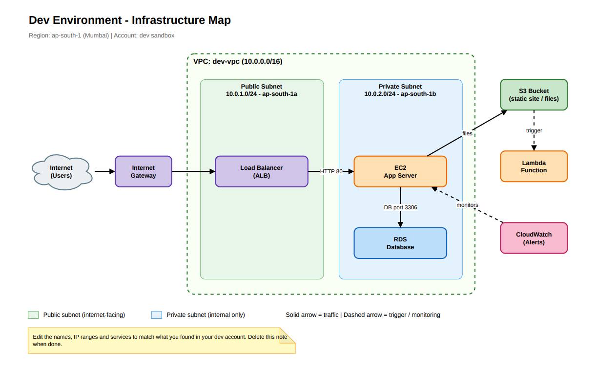
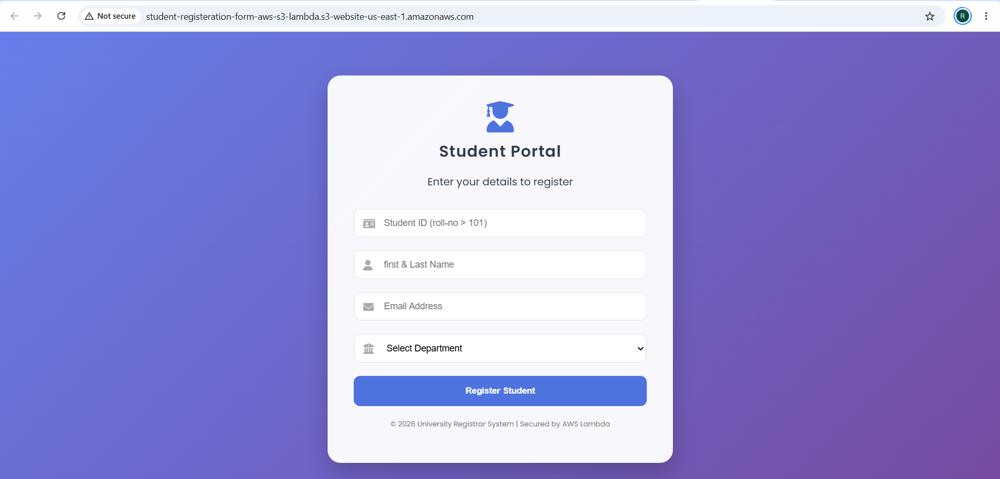
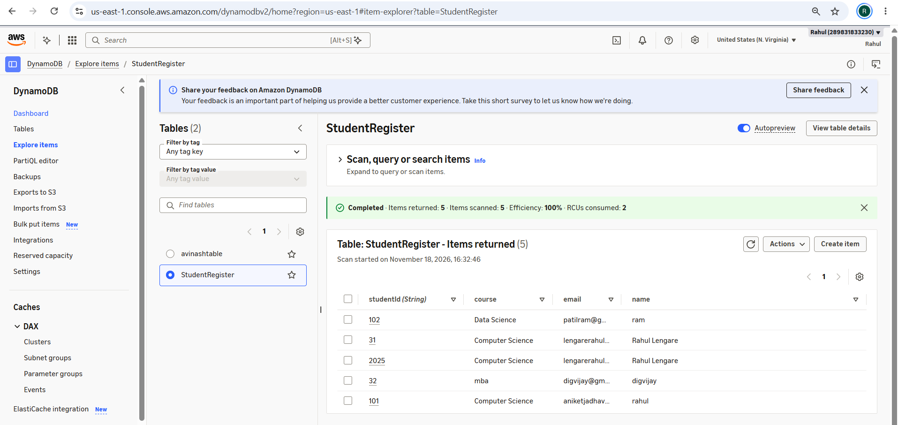

# Week 1 Projects: Cloud Computing Internship

**Name:** Rahul Lengare

**Role:** Cloud Computing Intern

**Company:** WeIntern Pvt Ltd

---

## Summary

| Task | What I did | Output | 
|------|------------|--------|
| 1. Cloud Account Onboarding | Safe login with MFA, AWS CLI set up | Working IAM login and CLI |
| 2. Infrastructure Map | Drew the dev environment in draw.io | Architecture diagram | 
| 3. Static Site with CDN | Put a web page online with S3 and CloudFront | Live CloudFront URL, bucket policy | 
| 4. Automation Script | Python script that lists tagged servers and estimates cost | `cost_estimator.py` and its output |
| 5. Basic Alerts | CPU and cost alarms with email | Alarms and an alert email | 
| 6. Tech Debrief | Summary of the week and one problem solved | This README | 

---

## Tools I Used

- **Cloud:** AWS (IAM, VPC, S3, CloudFront, EC2, CloudWatch)
- **Code and terminal:** AWS CLI, Python (boto3)
- **Drawing and saving work:** draw.io, Git, GitHub

## Task 1: Cloud Account Onboarding

**What I did:** Set up safe access to the cloud dev account.

**How I did it:**
- Logged in with my own IAM user (not the root account).
- Turned on MFA with an authenticator app.
- Installed the AWS CLI and set it up with `aws configure` (region: Mumbai).
- Checked access with `aws sts get-caller-identity`, `aws s3 ls` and `aws ec2 describe-instances`.

**Output:** Login with MFA works, and the CLI works.

---

## Task 2: Infrastructure Map

**What I did:** Looked at the dev environment and drew a map of it.

**How I did it:**
- Found the VPCs and subnets in the VPC console and used the Resource map.
- Decided which subnets are public and which are private.
- Listed the main services with Tag Editor.
- Checked security groups and triggers to see how the services connect.
- Drew the result in draw.io. (This task was read only.)

**Output:** The architecture diagram (`infrastructure-diagram.png` and `.drawio`).

---

## Task 3: Static Site with CDN

**What I did:** Put a web page (a Student Portal form) online with S3 and CloudFront.

**How I did it:**
- Created a private S3 bucket (Block Public Access stays on).
- Uploaded `index.html`.
- Created a CloudFront distribution with Origin Access Control and HTTPS.
- Added a bucket policy so only that CloudFront distribution can read the files (`bucket-policy.json`).
- Tested the form with fake data. It sends data to API Gateway, then Lambda, then DynamoDB.

**Output:** The site is live at `http://student-registeration-form-aws-s3-lambda.s3-website-us-east-1.amazonaws.com/`.

---

## Task 4: Automation Script

**What I did:** Wrote a Python script that lists running servers with a tag and estimates their cost.

**How I did it:**
- Wrote `cost_estimator.py` with boto3. It finds running EC2 instances with the tag `Env=Dev` and prints a cost table.
- The script is read only (it only uses `ec2:DescribeInstances`).
- Launched one small test server (`dev-test-instance`, `t3.micro`, Mumbai) so there was something to list.
- Ran: `python cost_estimator.py --region ap-south-1 --price t3.micro=0.0112`

**Output:** 1 running instance, about $0.0112 per hour, or about $8.18 per month (estimate only).

---

## Task 5: Basic Alerts

**What I did:** Set up alarms for high CPU and for cost, with an email alert.

**How I did it:**
- Turned on billing alerts and created an SNS topic with my email.
- Created `Dev-Sandbox-High-CPU-Alarm`: CPU of 70% or more for 5 minutes on the test server.
- Created `Dev-Sandbox-Cost-Threshold-Alarm` in us-east-1: estimated charges above $0.01.
- Tested with `aws cloudwatch set-alarm-state`, then reset the alarms to OK.

**Output:** Both alarms went to ALARM in the test, and the alert email arrived.

---

## Task 6: Tech Debrief

I presented the infrastructure map, the static site and the script to my mentor.

**One challenge I solved:** When I ran `cost_estimator.py`, it stopped with `AuthFailure`. The AWS CLI had worked in another terminal, so the account was fine. My script showed that this terminal (MSYS2) was using an old saved access key from its own `.aws` folder. I ran `aws configure` in the same terminal with a valid key, checked it with `aws sts get-caller-identity`, and the script then worked.

**Lesson:** `AuthFailure` means the key is wrong. `AccessDenied` means a permission is missing. Always run `aws sts get-caller-identity` in the same terminal first.

---

## Final Evaluation

**Result:** I completed the six Week 1 tasks. Each one has working output and a screenshot as proof.

**What went well**
- Everything follows the security rules: IAM user with MFA, private bucket, read-only script.
- The tag `Env=Dev` made the script easy to filter.
- Clear steps and screenshots make every task easy to repeat.

**What was hard**
- The `AuthFailure` problem in Task 4 (solved, see Task 6).

**What I learned**
- How to set up a safe cloud account and use the AWS CLI.
- How a cloud network (VPC, public and private subnets) is built.
- How to host a website safely with S3 and CloudFront.
- How to use Python (boto3) to check cloud resources and cost.
- How to set up alarms that warn me by email.

**What I would improve**
- Get prices from the AWS Pricing API instead of a small table.
- Add an email action to the cost alarm (the SNS topic must be in the same region).
- Test the CPU alarm with real load, not only a forced alarm state.

**Cleanup after review:** terminate the test server, delete the CloudFront distribution and the new bucket, and delete the alarms and the SNS topic. I keep the repository as my record.