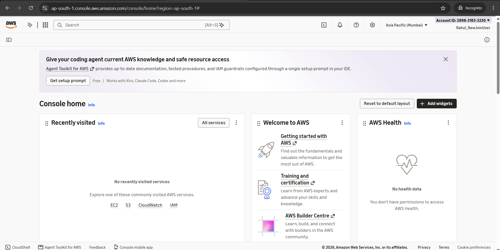
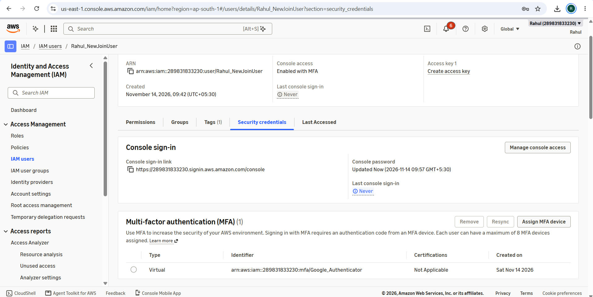
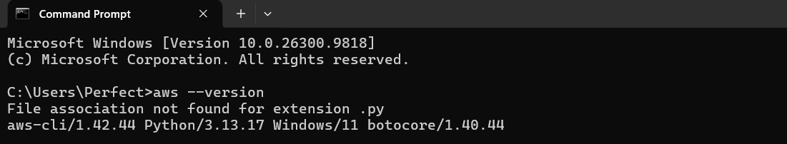
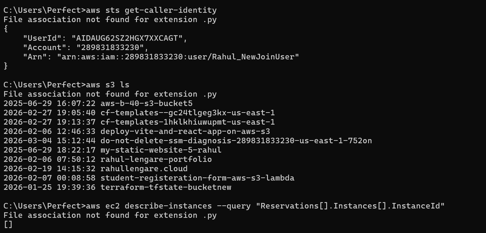

# Task 1: Cloud Account Onboarding
## About This Task

**What the task is:** Set up secure access to the company's cloud dev sandbox and learn the team's tagging and naming rules.

**Why it matters:** Every later task (infrastructure map, static site, script, alerts) depends on having working access. Security (MFA, IAM user) and tagging rules must be followed from day one.

**What I had to do:**
1. Set up my IAM user
2. Enable MFA
3. Install the cloud CLI
4. Verify access to the dev sandbox
5. Review the tagging and naming conventions

**Deliverable:** Checklist signed off by my mentor.


## Step-by-Step Guide

### Step 1: Log in with the IAM user
1. Open the sign-in URL given by the mentor.
2. Enter the account ID, username and temporary password.
3. Set a new password when asked.

> Use the IAM user. **Never use the root account.**




### Step 2: Enable MFA
1. Install an authenticator app on your phone (Google Authenticator, Authy or Microsoft Authenticator).
2. In the console go to **IAM → Users → your username → Security credentials**.
3. Click **Assign MFA device** and choose **Authenticator app**.
4. Scan the QR code with the app.
5. Enter two consecutive codes from the app and click **Add MFA**.



### Step 3: Create an access key (skip if the mentor already gave you one)
1. On the same **Security credentials** page, click **Create access key**.
2. Choose **Command Line Interface (CLI)**.
3. Copy the Access Key ID and Secret Access Key and store them safely.

> The secret key is shown only once. Never put it in Git, a README or a screenshot.

No screenshot for this step, because it shows secrets.


### Step 4: Install the AWS CLI
- **Windows:** download and run the MSI installer from the AWS CLI docs.
- **macOS:** `brew install awscli`
- **Linux:** follow the install commands in the AWS CLI docs.

Check the install:
```bash
aws --version
```


### Step 5: Configure the CLI
```bash
aws configure
```
Enter:
- Access Key ID
- Secret Access Key
- Default region (e.g. `ap-south-1`)
- Output format: `json`

### Step 6: Verify access to the dev sandbox
```bash
aws sts get-caller-identity
aws s3 ls
aws ec2 describe-instances --query "Reservations[].Instances[].InstanceId"
```
- The first command should show your account ID and user ARN.
- The other two should return results or an empty list, not `AccessDenied`.
- If you get `AccessDenied`, tell your mentor.



### Step 7: Review the tagging and naming conventions
Open the team's conventions document and write down the rules below. You will use them in every later task, especially Task 4, where the script filters by tag.

**Required tags**

| Tag key | Example value |
|---------|---------------|
| `Env` | `Dev` |
| `Owner` | `<my name>` |
| `Project` | `<project name>` |

**Naming pattern:** `<e.g. dev-<service>-<name>>`

### Step 8: Get the checklist signed off

| # | Item | Status | Evidence |
|---|------|--------|----------|
| 1 | Logged in with IAM user (not root) | ☐ | Screenshot 1 |
| 2 | MFA enabled | ☐ | Screenshot 2 |
| 3 | AWS CLI installed | ☐ | Screenshot 3 |
| 4 | Dev sandbox access verified | ☐ | Screenshot 4 |


## Cleanup: How to Delete or Remove Resources

Task 1 creates **no billable cloud resources**, so there is nothing to shut down to avoid charges. Do the cleanup below only at the right time.

**Do not clean up yet.** You need your access, MFA and CLI for Tasks 2 to 6. Do this only **after the internship ends** or when your mentor says so.

**A. Remove the CLI credentials from your computer**
```bash
# See what is stored
aws configure list-profiles

# Delete the stored credentials (Linux/macOS)
rm ~/.aws/credentials ~/.aws/config
```
On Windows, delete the files in `C:\Users\<you>\.aws\`.

**B. Delete the access key in the cloud console**
1. Go to **IAM → Users → your username → Security credentials**.
2. Under **Access keys**, click **Actions → Deactivate**, then **Delete**.

**C. Delete local screenshots and notes with sensitive data**
Delete any screenshot that still shows account IDs, keys or QR codes. Keep only the cropped or blurred copies in the repo.

**D. Leave these alone**
- Your IAM user and MFA device: the mentor or admin manages these.
- Do not delete your MFA device unless an admin asks you to.

**Quick check:** run `aws sts get-caller-identity`. It should now fail with an "Unable to locate credentials" error, which means the cleanup worked.

