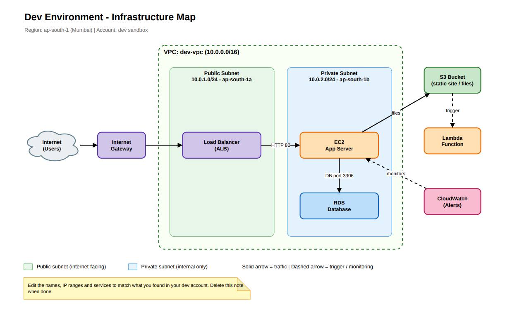

# Task 2: Infrastructure Map

## 1. About This Task

**What the task is:** Explore the existing dev environment and draw its architecture: VPCs, subnets, key services, and how the services connect.

**Why it matters:** The diagram is my reference for the rest of the internship. Knowing what already exists helps me avoid mistakes in later tasks.

**Deliverable:** Architecture diagram (`.png` or `.pdf`) made in draw.io.

> **This task is read-only.** I only looked at resources in the AWS Console. I did not create, change or delete anything.

## 2. Step-by-Step Guide

### Step 1: Check the account and region
In the AWS Console, look at the top right. Confirm it shows the **dev sandbox account** and the **region** your team uses. Resources are shown per region, so if something seems missing, switch the region from the dropdown.


### Step 2: Find the VPC, subnets and gateways
1. Search for **VPC** in the console search bar and open it.
2. Click **Your VPCs** and note each VPC's name and CIDR range.
3. Click a VPC to open it, then open the **Resource map** tab. It draws the VPC with its subnets, route tables and gateways.
4. Write down each subnet's name, CIDR and availability zone.
5. A subnet is **public** if its route table has a route to an **Internet Gateway (igw-...)**. Otherwise it is **private**. Check this under **Route tables**.


### Step 3: List the key services
1. Search for **Resource Groups & Tag Editor** and open **Tag Editor**.
2. Select your region, set Resource types to **All supported resource types**, and click **Search resources**.
3. Note the key services: EC2, RDS, Load Balancer, Lambda, S3 and so on.

If you want more detail on one service, open its own page (for example **EC2 → Instances**) and note which subnet it is in.


### Step 4: Work out how the services connect
Check these places in the console:
- **EC2 → Security Groups → Inbound rules:** shows which service can reach which, and on what port
- **EC2 → Load Balancers → Targets:** shows which servers sit behind the load balancer
- **Lambda → function → Triggers:** shows what starts the function

Write the result as simple lines, for example:
```
Internet -> Load Balancer -> EC2 (private subnet) -> RDS database
S3 bucket -> Lambda function
```
If you are not sure about a connection, ask your mentor instead of guessing.


### Step 5: Draw the diagram in draw.io
1. Open **app.diagrams.net** and create a blank diagram.
2. Turn on the AWS icons: **More Shapes → AWS Architecture**.
3. Draw in this order:
   - A large box for each **VPC**, labelled with name and CIDR
   - **Subnet** boxes inside, marked public or private, with CIDR and availability zone
   - The **services** inside the subnet where they run
   - Services outside the VPC (S3, Lambda, CloudFront) around the edge
   - **Arrows** for the connections from Step 4
4. Add a title and the date.

Example layout:
```
Internet
   |
[ Internet Gateway ]
   |
+------------------- VPC 10.0.0.0/16 -------------------+
|  [ Public subnet ]          [ Private subnet ]         |
|   Load Balancer  ------->    EC2 -------> RDS          |
+--------------------------------------------------------+
S3 bucket ----> Lambda
```


### Step 6: Export and save
1. **File → Export as → PNG** (tick *Include a copy of my diagram*). Name it `infrastructure-diagram.png`.
2. **File → Save as** `infrastructure-diagram.drawio` to keep the editable file.
3. Put both in this task's folder.



**Quick check before sharing**
- [ ] Every VPC and subnet is shown with its CIDR
- [ ] Public and private subnets are marked
- [ ] Every service from Step 3 is on the diagram
- [ ] Every connection from Step 4 has an arrow
- [ ] Account ID and sensitive values are blurred or removed

## 3. Key Terms

| Term | What it is |
|------|------------|
| **VPC** | Your private network inside AWS. The biggest box in the diagram. |
| **Subnet** | A smaller part of a VPC, in one availability zone. Servers live here. |
| **CIDR** | A way of writing an IP range, such as `10.0.0.0/16`. |
| **Availability Zone** | A separate data centre location in a region, such as `ap-south-1a`. |
| **Public subnet** | A subnet with a route to an Internet Gateway. |
| **Private subnet** | A subnet with no direct route to the internet. |
| **Internet Gateway** | The door between a VPC and the internet. |
| **Route table** | Rules that decide where network traffic goes. Used to tell public from private. |
| **Security group** | A firewall for a resource. Shows which services connect to which. |

## 4. Cleanup

This task is read-only, so there is nothing to delete in the cloud. **Do not change anything in the dev account.**

- **Keep:** `infrastructure-diagram.png` and `infrastructure-diagram.drawio`. You will use them all internship.
- **Remove:** screenshots that still show the account ID, and any draft diagrams you no longer need.
