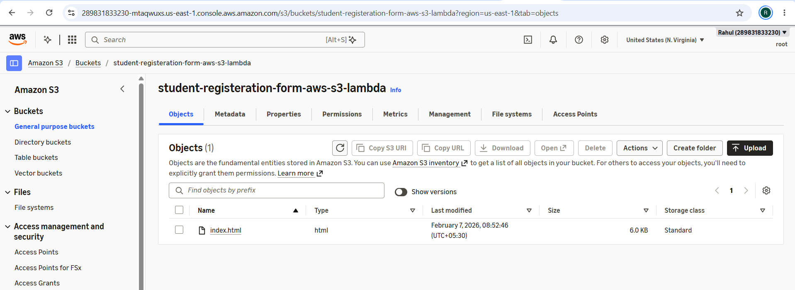
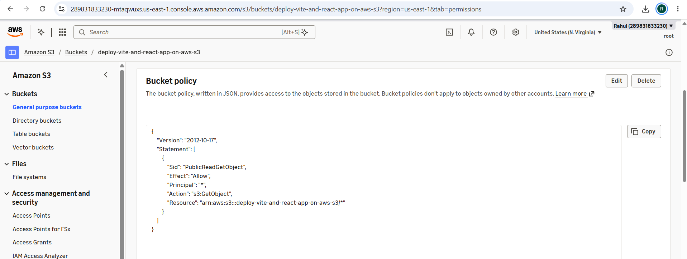
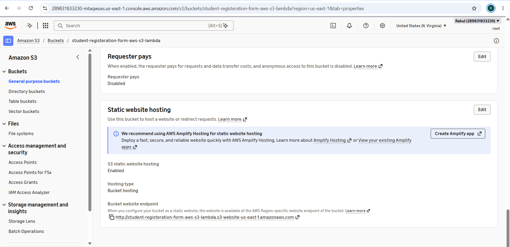
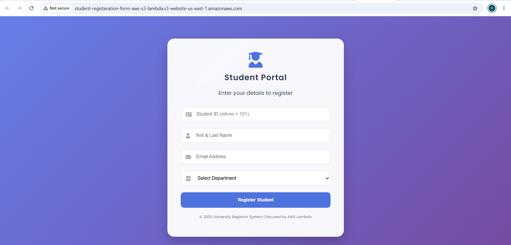

# Task 3: Deploy a Static Site via S3 + CloudFront

## 1. About This Task

**What the task is:** Create an S3 bucket, host a static site from it, put a CloudFront CDN in front, and document every step, including the bucket policy (IAM policy) that was applied.

**Why it matters:** This is the most common way to host a website cheaply on AWS. It also practises the security rules from day one: the bucket stays **private** and only CloudFront can read it.

**Deliverable:** Live CloudFront URL + deployment notes (this README) + the policy JSON.

### Which site I deployed
The site is the **Student Portal**, a single-page registration form (`index.html`, about 6 KB).
- When a student submits the form, the page sends the data to an API: **API Gateway → Lambda → DynamoDB**.
- The page and its API come from an earlier personal project of mine. For this task I created a **new bucket, a new CloudFront distribution and a new bucket policy** and deployed the page on them.

```
Browser --> CloudFront (CDN, HTTPS) --> S3 bucket (private, holds index.html)
Browser --> (form submit) --> API Gateway --> Lambda --> DynamoDB
```

> **This task creates billable resources** (very small cost). See Section 6 for cleanup after my mentor has reviewed it.


## 2. Step-by-Step Guide

### Step 1: Check the site file
Open `index.html` and confirm two things:
- It contains **no access keys or secrets**. It doesn't; the only setting is `API_URL`, which is the public API address.
- `API_URL` points to the correct API (`https://<api-id>.execute-api.<region>.amazonaws.com/prod/register`).

---

### Step 2: Create the S3 bucket
1. In the AWS Console, search for **S3** and click **Create bucket**.
2. **Bucket name:** globally unique and lowercase, following the team naming pattern (for example `dev-student-portal-<yourname>-<number>`).
3. **Region:** the region your team uses.
4. **Block all public access:** leave it **ON** (the default). The bucket must stay private.
5. **Tags:** add the team's required tags (for example `Env=Dev`, `Owner=<my name>`, `Project=<project>`).
6. Click **Create bucket**.

---

### Step 3: Upload the site file
1. Open the bucket and click **Upload**.
2. Add `index.html` and click **Upload**.



---

### Step 4: Create the CloudFront distribution
1. Search for **CloudFront** and click **Create distribution**.
2. **Origin domain:** choose your S3 bucket from the list. (Use the bucket itself, **not** the S3 "website endpoint".)
3. **Origin access:** select **Origin access control settings (recommended)** and click **Create new OAC** (keep the defaults).
4. **Viewer protocol policy:** Redirect HTTP to HTTPS.
5. **Default root object:** `index.html`
6. Leave the cache settings at their defaults and do not enable WAF.
7. Add the same tags as the bucket, then click **Create distribution**.
8. A banner will say the bucket policy needs to be updated. Click **Copy policy** and go to Step 5.

> **Why no "Static website hosting" setting?** That S3 feature needs a public bucket. Here CloudFront serves `index.html` as the default root object and the bucket stays private, which follows our security policy.

---

### Step 5: Apply the bucket policy (the IAM policy for this task)
1. Open the bucket, then **Permissions → Bucket policy → Edit**.
2. Paste the policy you copied from CloudFront and save. It looks like this (also saved as `bucket-policy.json`):
```json
{
  "Version": "2012-10-17",
  "Statement": [
    {
      "Sid": "AllowCloudFrontServicePrincipalReadOnly",
      "Effect": "Allow",
      "Principal": { "Service": "cloudfront.amazonaws.com" },
      "Action": "s3:GetObject",
      "Resource": "arn:aws:s3:::<bucket-name>/*",
      "Condition": {
        "StringEquals": {
          "AWS:SourceArn": "arn:aws:cloudfront::<account-id>:distribution/<distribution-id>"
        }
      }
    }
  ]
}
```
**What it does:** it allows only this one CloudFront distribution to read (`GetObject`) files from the bucket. Nobody else, including the public internet, can read them directly.



---

### Step 6: Wait for deployment and copy the URL
1. Open **CloudFront → Distributions**. Wait until the status shows **Deployed** (a few minutes).
2. Copy the **Distribution domain name** (looks like `dxxxxxxxxxxxx.cloudfront.net`).




### Step 7: Test the live site
1. Open `https://<your-domain>.cloudfront.net`. The Student Portal form should appear.
2. Fill in the form with **fake test data** (for example Student ID `105`, name `Test Student`, email `test@example.com`) and click **Register Student**.
3. You should see the message "Success! Student record saved to DynamoDB."
4. If you see "Connection Error" instead, go to Step 8.




### Step 8: Record the deployment notes

| Item | Value |
|------|-------|
| Bucket name | `<bucket-name>` |
| Region | `<region>` |
| Distribution ID | `<distribution-id>` |
| **Live URL** | `https://<your-domain>.cloudfront.net` |
| Bucket access | Private, read only by CloudFront (OAC) |
| Form API | API Gateway `/prod/register` → Lambda → DynamoDB |
| Date deployed | `<DD-MM-YYYY>` |

**Quick check before sharing**
- [ ] Block Public Access is ON for the bucket
- [ ] The live URL opens over HTTPS and shows the Student Portal
- [ ] The form submits successfully with test data
- [ ] Bucket policy JSON is saved in this repo
- [ ] Account ID is blurred in the screenshots

### Updating the site later (optional, CLI)
```bash
aws s3 cp index.html s3://<bucket-name>/index.html
aws cloudfront create-invalidation --distribution-id <distribution-id> --paths "/*"
```
The invalidation makes CloudFront drop its cached copy so the new file shows straight away.


## 4. Key Terms

| Term | What it is |
|------|------------|
| **S3** | AWS storage service. Files are kept in buckets. |
| **Bucket** | A container for files. Its name must be unique worldwide. |
| **CloudFront** | AWS CDN (Content Delivery Network). It serves cached copies of your site from locations near the user. |
| **Origin** | The place CloudFront gets files from. Here it is the S3 bucket. |
| **OAC** | Origin Access Control. Lets CloudFront read a private bucket securely. |
| **Bucket policy** | A JSON rule that says who may do what with the bucket. |
| **Block Public Access** | An S3 safety switch that stops the bucket from becoming public. |
| **Default root object** | The file CloudFront returns for the home URL (`index.html`). |
| **Invalidation** | Telling CloudFront to drop cached files so updates appear. |
| **API Gateway** | The service that gives the form a public API address. |
| **Lambda** | Code that runs on demand. It receives the form data. |
| **DynamoDB** | The database table where the student records are saved. |
| **CORS** | A browser rule for calls between different sites. The API must allow the CloudFront address. |


## 5. Cleanup

This task creates real resources, so clean them up **after my mentor has reviewed the live URL** (or when the mentor says so). The cost is very small, but unused resources should not be left running.

1. **Empty the bucket:** S3 → select the bucket → **Empty**.
2. **Disable the distribution:** CloudFront → select it → **Disable**. Wait until it finishes updating.
3. **Delete the distribution:** select it again → **Delete**.
4. **Delete the OAC (optional):** CloudFront → **Origin access** → delete the one created for this task.
5. **Delete the bucket:** S3 → select the bucket → **Delete**.

**Do not delete** the API Gateway, Lambda function or DynamoDB table. They were not created for this task.
**Keep:** this README, `bucket-policy.json` and the screenshots as proof of the work.
