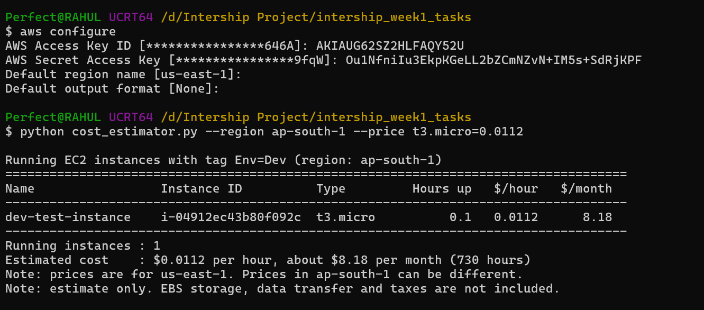

# Task 4: Automate with a Python Script

## 1. About This Task

**What the task is:** Write a script that lists all running compute instances in the dev account, filters them by tag, and prints a cost-estimate summary. Commit it to the team repo with a clear README.

**Why it matters:** Instances that are left running quietly cost money. A small script gives a fast, repeatable way to see what is running and roughly what it costs, and it uses the tagging rules from Task 1.

**Deliverable:** `cost_estimator.py` in the Git repo + this README.

**What the script does:**
1. Connects to AWS with `boto3`, using the credentials from `aws configure`.
2. Finds EC2 instances that are **running** and have the tag **`Env=Dev`** (configurable).
3. Prints a table with name, instance ID, type, hours up, price per hour and estimated price per month.
4. Prints a total cost estimate.

> **The script is read-only.** It only calls `ec2:DescribeInstances`. It never creates, changes or deletes anything, and it has no keys inside.

---

## 2. Step-by-Step Guide

### Step 1: Check Python and boto3
```bash
python --version
python -m pip install boto3
```
On Windows you can also use `py` instead of `python`. If Python is missing, install it from python.org and tick **Add Python to PATH**.

---

### Step 2: Check the AWS access in the terminal you will use
```bash
aws sts get-caller-identity
```
This must show my IAM user (as in Task 1). The script needs the permission `ec2:DescribeInstances`.

> If you use more than one terminal (Command Prompt, Git Bash, MSYS2), each one can have its own saved credentials. Run this check, and `aws configure` if needed, in the **same terminal** where you will run the script.

---

### Step 3: Make sure a tagged instance exists
The script can only list instances that exist. The dev account had no running instance tagged `Env=Dev`, so I launched one small test instance in Mumbai:
1. Sign in as the IAM user (not root) and set the region to **Asia Pacific (Mumbai) ap-south-1**.
2. Open **EC2 → Instances → Launch instances**.
3. **Name and tags:** Name `dev-test-instance`. Click **Add additional tags** and add `Env = Dev`, `Owner = Rahul Lengare` and `Project = <project name>`. Tick both **Instances** and **Volumes**.
4. **Image:** Amazon Linux 2023 (the default).
5. **Instance type:** `t3.micro`.
6. **Key pair:** **Proceed without a key pair**. I do not log in to this server.
7. **Network settings:** default VPC and subnet. **Untick "Allow SSH traffic from anywhere"**, because I do not need SSH and it should not be open to the internet.
8. **Storage:** the default 8 GiB. Leave **Advanced details** as they are (no detailed monitoring, which costs extra).
9. Click **Launch instance**, then wait until the state is **Running** and the status checks have passed.
10. Open the **Tags** tab and confirm `Env = Dev`.

> A `t3.micro` in Mumbai costs about $0.0112 per hour. I keep it until Task 5 is finished (the CPU alarm needs an instance) and terminate it afterwards. See Section 7.


---

### Step 4: Add the script to the project
1. Put `cost_estimator.py` in the project folder.
2. How it works:
   - `parse_args` reads the options (`--tag-key`, `--tag-value`, `--region`, `--price` and so on).
   - `get_running_instances` asks AWS for instances that are `running` and match the tag, using a paginator so no instance is missed.
   - `PRICES` is a small table of hourly prices. The script multiplies by 730 hours for a monthly estimate.
   - `main` prints the table and totals, and shows a clear message for errors or when nothing matches.

---

### Step 5: Run the script
```bash
python cost_estimator.py --region ap-south-1 --price t3.micro=0.0112
```
The built-in prices are for `us-east-1`. For Mumbai I gave the `t3.micro` price with `--price`, so the script prints a note about `us-east-1` prices, which I can ignore for this instance.



> Crop the screenshot so it shows only the script run. Never include the `aws configure` step, because it shows the keys.

---

### Step 6: Sanity-check the result
- The instance in the table matches the one in the EC2 console.
- The hourly price matches the AWS EC2 pricing page for the instance type and region. The script's numbers are approximate.
- If the table shows `n/a` for a price, add it with `--price TYPE=PRICE`.

---

### Step 7: Push to Git
```bash
git add cost_estimator.py README_task4.md screenshots/
git commit -m "Add Task 4: cost estimator script"
git push
```
Check on GitHub that the script, the README and both screenshots appear and the images display.

---

## 3. Script Reference

### Usage
```bash
python cost_estimator.py [options]
```

| Option | Default | Meaning |
|--------|---------|---------|
| `--tag-key` | `Env` | Tag key to filter by |
| `--tag-value` | `Dev` | Tag value to filter by |
| `--region` | from `aws configure` | AWS region to check |
| `--profile` | default profile | AWS CLI profile to use |
| `--price TYPE=PRICE` | none | Add or change an hourly price (can be repeated) |

### Output from my run
```
Running EC2 instances with tag Env=Dev (region: ap-south-1)
====================================================================================
Name                 Instance ID          Type         Hours up   $/hour   $/month
------------------------------------------------------------------------------------
dev-test-instance    i-04912ec43b80f092c  t3.micro          0.1   0.0112      8.18
------------------------------------------------------------------------------------
Running instances : 1
Estimated cost    : $0.0112 per hour, about $8.18 per month (730 hours)
Note: prices are for us-east-1. Prices in ap-south-1 can be different.
Note: estimate only. EBS storage, data transfer and taxes are not included.
```

### Limits of the estimate
- The built-in prices are approximate **On-Demand Linux prices for `us-east-1`**. Other regions differ, so use `--price` with the price from the AWS pricing page (for Mumbai, `t3.micro` is about $0.0112 per hour).
- EBS storage, data transfer, taxes, Windows licences and discounts are **not** included.
- "Hours up" counts from the instance's last start time.
- Only EC2 instances are covered, not RDS, Lambda or other services.

---

## 4. Screenshots Needed

| After | Capture | File name |
|-------|---------|-----------|
| Step 3 | Running instance with its `Env=Dev` tag | `ec2-tagged-instance.png` |
| Step 5 | Script output in the terminal | `script-output.png` |

Blur the account ID in every screenshot.

---

## 5. Key Terms

| Term | What it is |
|------|------------|
| **EC2 instance** | A virtual server running in AWS. |
| **boto3** | The AWS library for Python. It lets a script talk to AWS. |
| **Tag** | A key-value label on a resource, such as `Env=Dev`. Used here to pick which instances to list. |
| **Filter** | A condition sent to AWS so it returns only matching items (running + tagged). |
| **Paginator** | A boto3 helper that collects results across several pages, so no instance is missed. |
| **On-Demand price** | The normal pay-as-you-go price per hour, with no commitment. |
| **Region** | The AWS location. Instances and prices differ per region. |
| **`ec2:DescribeInstances`** | The permission that lets me read the list of instances. It is the only one the script needs. |

---

## 6. Issues and Fixes

### The problem I hit

| Issue | Cause | Fix |
|-------|-------|-----|
| The script stopped with `AuthFailure`, and `aws sts get-caller-identity` gave `InvalidClientTokenId` | The terminal I used (MSYS2) had its own saved access key, an old one that AWS no longer accepted. The Windows Command Prompt had a different, working key. | Ran `aws configure` in that same terminal with a valid access key, confirmed it with `aws sts get-caller-identity`, then ran the script again. |

I also changed the script so it now reports where the credentials came from and the last 4 characters of the key. That makes this kind of problem quick to find.

### Other common problems

| Problem | Cause | Fix |
|---------|-------|-----|
| `No module named 'boto3'` | boto3 is not installed | Run `python -m pip install boto3` |
| `Permission denied (UnauthorizedOperation)` | The IAM user cannot describe instances | Ask the mentor to add `ec2:DescribeInstances` |
| `No running instances found` | Wrong region, tag or instance state | Use `--region`, check the tag spelling, and check the instance is Running |
| Price shows `n/a` | The instance type is not in the price table | Add it with `--price TYPE=PRICE` |

---

## 7. Cleanup

The script itself creates nothing. Only the **test instance from Step 3** needs cleaning up.

1. Wait until Task 5 (alerts) is finished and my mentor has reviewed this task.
2. Open **EC2 → Instances**, select `dev-test-instance`, then choose **Instance state → Terminate instance**. (Use Terminate, not Stop. A stopped instance still pays for its disk.)
3. Check that the state changes to **Terminated**.

**Do not terminate** any instance that I did not create.
**Keep:** `cost_estimator.py`, this README and the screenshots.


## 8. Folder Structure

```
internship-week1-tasks/
├── README_task4.md
├── cost_estimator.py
└── screenshots/
    ├── ec2-tagged-instance.png
    └── script-output.png
```