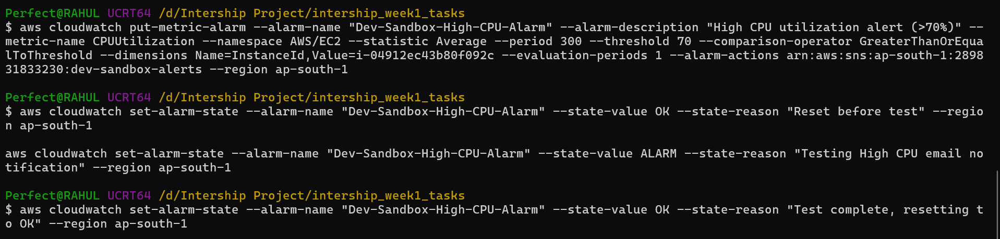
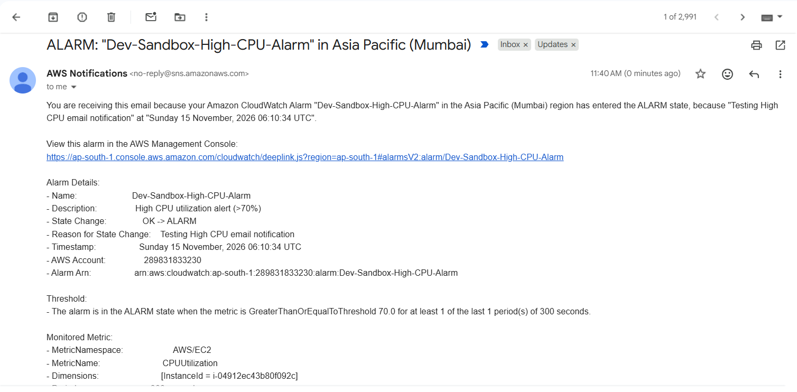

# Task 5: Set Up Basic Alerts

## 1. About This Task

**What the task is:** Configure CPU and cost threshold alerts on the dev sandbox using AWS CloudWatch, verify that the alerts fire correctly (including email notifications via SNS and artificial CPU load testing), and document the setup process.

**Why it matters:** Without alerts, a stuck server running at 100% CPU or an unexpected cloud charge can go unnoticed for days. Connecting CloudWatch alarms to an SNS email topic gives an immediate warning in my inbox when compute usage or spending crosses a safe limit.

**Deliverable:** Alert configuration and email verification screenshots + brief write-up (`README_task5.md`).

**What I had to do:**
1. Turn on billing alerts in the AWS account preferences.
2. Create an SNS topic (`dev-sandbox-alerts`) and confirm my email subscription.
3. Create a CPU utilization alarm (`Dev-Sandbox-High-CPU-Alarm`) linked to my test EC2 instance (`i-04912ec43b80f092c` in `ap-south-1`) and my SNS email topic (`>= 70%`).
4. Create a Free-Tier cost threshold alarm (`Dev-Sandbox-Cost-Threshold-Alarm`) for estimated charges (`> $0.01 USD` in `us-east-1`).
5. Verify the alerts by increasing CPU utilization / triggering the `ALARM` state and confirming the email notification arrived.
6. Stop the artificial load and reset the alarms back to `OK`.

> **Free Tier note:** AWS Free Tier includes up to 10 CloudWatch metric alarms and 1,000 SNS email notifications per month at no charge, so this entire setup and verification stays at `$0.00` cost.

---

## 2. Step-by-Step Guide

### Step 1: Enable billing alerts in the console
Before CloudWatch can track account charges, billing alerts must be switched on once in the account:
1. Open **Billing and Cost Management** in the AWS Console.
2. Click **Billing preferences** in the left menu.
3. Next to **Alert preferences**, click **Edit**.
4. Tick **Receive CloudWatch billing alerts** and click **Update**.

> AWS stores billing metrics in **US East (N. Virginia) `us-east-1`**, so the cost alarm is created in `us-east-1`.

---

### Step 2: Create an SNS topic and subscribe my email
To receive an email when an alarm fires, CloudWatch uses **Amazon SNS (Simple Notification Service)**.

1. Create the SNS topic in Mumbai (`ap-south-1`, where my EC2 instance from Task 4 runs):
```bash
aws sns create-topic --name dev-sandbox-alerts --region ap-south-1
```
2. Subscribe my email address to the topic ARN returned by the first command:
```bash
aws sns subscribe \
  --topic-arn arn:aws:sns:ap-south-1:<account-id>:dev-sandbox-alerts \
  --protocol email \
  --notification-endpoint <my-email@example.com> \
  --region ap-south-1
```
3. Open my email inbox, find the message from **AWS Notifications**, and click **Confirm subscription**.

---

### Step 3: Create the High CPU utilization alarm (linked to EC2 + SNS)
Run this command to create `Dev-Sandbox-High-CPU-Alarm` in `ap-south-1`. It watches the `CPUUtilization` metric for my running test instance (`i-04912ec43b80f092c`) and sends an email via SNS when average CPU is `70%` or higher over 5 minutes (`300` seconds):

```bash
aws cloudwatch put-metric-alarm \
  --alarm-name "Dev-Sandbox-High-CPU-Alarm" \
  --alarm-description "High CPU utilization alert (>70%)" \
  --metric-name CPUUtilization \
  --namespace AWS/EC2 \
  --statistic Average \
  --period 300 \
  --threshold 70 \
  --comparison-operator GreaterThanOrEqualToThreshold \
  --dimensions Name=InstanceId,Value=i-04912ec43b80f092c \
  --evaluation-periods 1 \
  --alarm-actions arn:aws:sns:ap-south-1:<account-id>:dev-sandbox-alerts \
  --region ap-south-1
```

---

### Step 4: Create the Cost threshold alarm (Free Tier safe)
Run this command to create a billing alarm in `us-east-1` that watches `EstimatedCharges` and triggers if monthly spending goes above `$0.01 USD`:

```bash
aws cloudwatch put-metric-alarm \
  --alarm-name "Dev-Sandbox-Cost-Threshold-Alarm" \
  --alarm-description "Free Tier Cost Alert (>$0.01)" \
  --metric-name EstimatedCharges \
  --namespace AWS/Billing \
  --statistic Maximum \
  --period 21600 \
  --threshold 0.01 \
  --comparison-operator GreaterThanThreshold \
  --dimensions Name=Currency,Value=USD \
  --evaluation-periods 1 \
  --region us-east-1
```

---

### Step 5: Check that the alarms exist
```bash
aws cloudwatch describe-alarms --region ap-south-1 --query "MetricAlarms[].AlarmName"
aws cloudwatch describe-alarms --region us-east-1 --query "MetricAlarms[].AlarmName"
```
This returns the alarm names (`Dev-Sandbox-High-CPU-Alarm` and `Dev-Sandbox-Cost-Threshold-Alarm`) instead of an empty list `[]`.

---

### Step 6: Increase CPU utilization artificially & trigger the alerts
There are two ways to make the alarm fire and send the email alert:

**A. Artificial CPU load on the EC2 instance**
1. In **EC2 → Instances**, connect to `dev-test-instance` (`i-04912ec43b80f092c`) using **EC2 Instance Connect**.
2. Run two infinite background loops to push both vCPUs on the `t3.micro` instance to `100%` utilization:
```bash
yes > /dev/null &
yes > /dev/null &
```
3. Run `top` to confirm CPU usage is near `100%` (`0.0 id`). After 5 minutes, CloudWatch evaluates the metric above `70%` and triggers the alarm.
4. Once the alert triggers, stop the artificial CPU load immediately:
```bash
killall yes
```

**B. Instant CLI state test (zero wait time & `$0.00` cost for billing alarm)**
To test the alarm state change and email pipeline immediately from the terminal without waiting 5 minutes or spending money on the account:
```bash
# Reset CPU alarm to OK first, then trigger ALARM to fire the SNS email
aws cloudwatch set-alarm-state --alarm-name "Dev-Sandbox-High-CPU-Alarm" --state-value OK --state-reason "Reset before test" --region ap-south-1
aws cloudwatch set-alarm-state --alarm-name "Dev-Sandbox-High-CPU-Alarm" --state-value ALARM --state-reason "Testing High CPU email notification" --region ap-south-1

# Trigger the Cost threshold alarm in us-east-1
aws cloudwatch set-alarm-state --alarm-name "Dev-Sandbox-Cost-Threshold-Alarm" --state-value ALARM --state-reason "Testing Cost threshold alert on Free Tier" --region us-east-1
```



> **How I tested:** I used method B (`set-alarm-state`) to check the alert pipeline. It changes the alarm state and sends the real SNS email, but it does not create real CPU load. The alarm itself is set to fire at 70% average CPU.

---

### Step 7: Confirm the `ALARM` state, check email, and reset to `OK`
1. Check the terminal table to confirm both alarms entered the `ALARM` state:
```bash
aws cloudwatch describe-alarms --query "MetricAlarms[].[AlarmName,StateValue,StateReason]" --output table
aws cloudwatch describe-alarms --region us-east-1 --query "MetricAlarms[].[AlarmName,StateValue,StateReason]" --output table
```


2. Check my email inbox and confirm the **AWS Notifications** alert email arrived for `Dev-Sandbox-High-CPU-Alarm`.



3. After taking the screenshots, reset the alarms back to the normal `OK` state:
```bash
aws cloudwatch set-alarm-state --alarm-name "Dev-Sandbox-High-CPU-Alarm" --state-value OK --state-reason "Test complete, resetting to OK" --region ap-south-1
aws cloudwatch set-alarm-state --alarm-name "Dev-Sandbox-Cost-Threshold-Alarm" --state-value OK --state-reason "Test complete, resetting to OK" --region us-east-1
```

---

### Step 8: Push to Git
```bash
git add README_task5.md screenshots/
git commit -m "Add Task 5: CloudWatch CPU and cost threshold alerts with SNS email verification"
git push
```

---

## 3. Alarm Reference

### Alarms configured

| Alarm name | Region | Namespace & Metric | Target / Dimension | Condition | Action |
|------------|--------|--------------------|--------------------|-----------|--------|
| `Dev-Sandbox-High-CPU-Alarm` | `ap-south-1` | `AWS/EC2` `CPUUtilization` | `InstanceId = i-04912ec43b80f092c` | `Average >= 70%` for 5 mins (`300s`) | Sends email via SNS (`dev-sandbox-alerts`) |
| `Dev-Sandbox-Cost-Threshold-Alarm` | `us-east-1` | `AWS/Billing` `EstimatedCharges` | `Currency = USD` | `Maximum > $0.01 USD` for 6 hours (`21600s`) | Flags any charge above Free Tier |

### Terminal output from my run
```text
Perfect@RAHUL UCRT64 /d/Intership Project/intership_week1_tasks
$ aws cloudwatch describe-alarms --query "MetricAlarms[].[AlarmName,StateValue,StateReason]" --output table
aws cloudwatch describe-alarms --region us-east-1 --query "MetricAlarms[].[AlarmName,StateValue,StateReason]" --output table
-----------------------------------------------------------------------------------
|                                 DescribeAlarms                                  |
+-----------------------------------+--------+------------------------------------+
|  Dev-Sandbox-Cost-Threshold-Alarm |  ALARM |  Testing Cost threshold alert on Free Tier |
|  Dev-Sandbox-High-CPU-Alarm       |  ALARM |  Testing High CPU alert on Free Tier       |
+-----------------------------------+--------+------------------------------------+
```

### Email alert details received
```text
Subject: ALARM: "Dev-Sandbox-High-CPU-Alarm" in Asia Pacific (Mumbai)
From: AWS Notifications <no-reply@sns.amazonaws.com>

Alarm Details:
- Name:                   Dev-Sandbox-High-CPU-Alarm
- Description:            High CPU utilization alert (>70%)
- State Change:           OK -> ALARM
- Reason for State Change: Testing High CPU email notification
- Monitored Metric:       AWS/EC2 CPUUtilization [InstanceId = i-04912ec43b80f092c]
- Threshold:              GreaterThanOrEqualToThreshold 70.0 for 1 period(s) of 300 seconds
```

## 4. Key Terms

| Term | What it is |
|------|------------|
| **CloudWatch** | AWS monitoring service that collects metrics, logs and alarms for cloud resources. |
| **Metric** | A value that CloudWatch tracks over time, such as `CPUUtilization` or `EstimatedCharges`. |
| **Namespace** | A folder for metrics from one service, such as `AWS/EC2` or `AWS/Billing`. |
| **Dimension** | A name-value pair that identifies a specific resource, such as `InstanceId=i-04912ec43b80f092c`. |
| **Threshold** | The number that trips the alarm (here `70%` CPU or `$0.01 USD`). |
| **Evaluation period** | How many time windows must break the threshold before the alarm fires. |
| **Alarm states** | `OK` (normal), `ALARM` (threshold crossed) and `INSUFFICIENT_DATA` (waiting for data). |
| **SNS** | Simple Notification Service. Used by CloudWatch to send email alerts when an alarm fires. |
| **`set-alarm-state`** | An AWS CLI command that temporarily changes an alarm's state to verify notifications. |


## 5. Cleanup

Once Task 5 is reviewed by my mentor, clean up the test resources so no background alerts or EC2 hours continue running:

**A. Stop any artificial CPU load and reset alarms to `OK`**
```bash
# Inside the EC2 terminal (if yes loop was started)
killall yes

# In the local terminal
aws cloudwatch set-alarm-state --alarm-name "Dev-Sandbox-High-CPU-Alarm" --state-value OK --state-reason "Test complete" --region ap-south-1
```

**B. Terminate the test EC2 instance from Task 4 (`i-04912ec43b80f092c`)**
```bash
aws ec2 terminate-instances --instance-ids i-04912ec43b80f092c --region ap-south-1
```
*(Or in the console: **EC2 → Instances → select `dev-test-instance` → Instance state → Terminate instance**).*

**C. Delete the SNS topic and CloudWatch alarms (only when the mentor says so)**
```bash
aws sns delete-topic --topic-arn arn:aws:sns:ap-south-1:<account-id>:dev-sandbox-alerts --region ap-south-1
aws cloudwatch delete-alarms --alarm-names "Dev-Sandbox-High-CPU-Alarm" --region ap-south-1
aws cloudwatch delete-alarms --alarm-names "Dev-Sandbox-Cost-Threshold-Alarm" "Dev-Sandbox-High-CPU-Alarm" --region us-east-1
```
